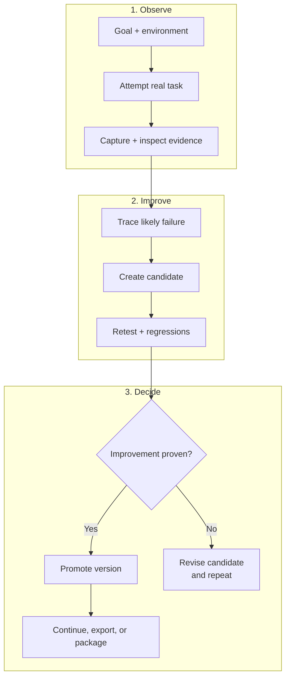

# Harneloop-Lebenszyklus - Kompakt

Diese Version zeigt nur die zentrale evidenzgestützte Harness-Entwicklungsschleife. Ihre drei gestapelten Zeilen sollen in GitHub Markdown lesbar bleiben und sich gut in eine Grafik von ungefähr 4:3 übertragen lassen.

Der promovierte Harness bleibt unverändert, bis die Evidenzprüfung eine Verbesserung bestätigt. Ein Kandidat kann zusammengehörige Änderungen bündeln, unabhängige Kandidaten können nebeneinander bestehen. Die Validierung richtet sich nach den Auswirkungen; ein abgelehnter Kandidat geht zur Diagnose und Überarbeitung zurück, ohne die aktuelle Version zu ersetzen.

Das vollständige Architekturdiagramm findet ihr unter [Wie Harneloop funktioniert](framework-process.md).

Der Mermaid-Rohtext ist unter [`docs/diagrams/framework-process-compact.mmd`](../../../diagrams/framework-process-compact.mmd) verfügbar.
