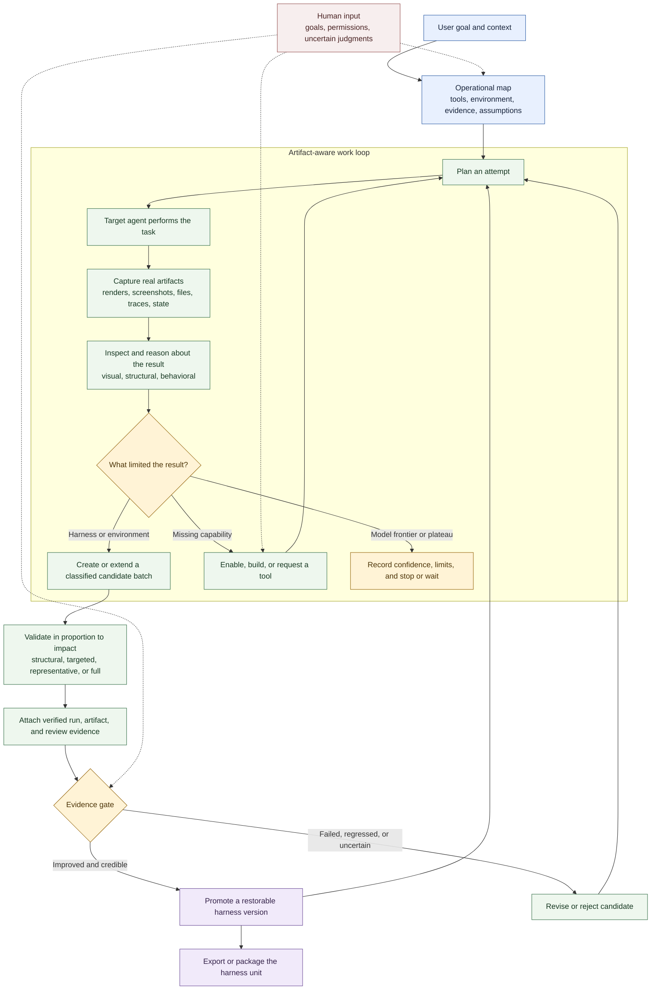

# Wie Harneloop funktioniert

Harneloop gibt einem operierenden Agenten eine dauerhafte, evidenzgebundene Schleife zur Verbesserung des Harness eines Zielagenten. Der Agent wählt weiterhin seine Arbeitsweise: Harneloop dokumentiert die sich entwickelnde Umgebung, Artefakte, Kandidatenänderungen und Promotionshistorie, ohne den Prozess auf ein festes Testskript zu reduzieren.

Eine kleinere dreistufige Version für das README oder eine Grafik von ungefähr 4:3 findet ihr im [kompakten Lebenszyklus](framework-process-compact.md).

## Die drei Rollen

**Der operierende Agent** erkundet die reale Umgebung, wählt Tests, nutzt oder ergänzt Fähigkeiten, prüft Artefakte, diagnostiziert Fehler und schlägt Harness-Kandidatenänderungen vor.

**Die Harness-Einheit** trägt wiederverwendbare Anweisungen, Werkzeuge, Beobachter, Validatoren, Beispiele, Infrastrukturdeklarationen, die Arbeitsübersicht, Kandidaten und promovierte Versionen für eine Aufgabenfamilie.

**Die Harneloop-Engine** verantwortet die Lebenszyklusintegrität: atomare Datensätze, unveränderliche abgeschlossene Ausführungen, geschützten Framework-Zustand, geprüfte Evidenzreferenzen, Kandidatenpromotion, Snapshots, Rollback, Paketierung und Exporte.

## Was sich entwickelt

Ein Kandidat kann mehr als einen Prompt ändern: Werkzeuge, Retrieval-Daten, Beispiele, Agentenanweisungen, Validatoren, Beobachter, Forschung, Infrastrukturdeklarationen oder Umgebungsautomatisierung. Er ist ein zusammenhängendes Bündel, sodass verwandte Änderungen ohne Volltest nach jedem Schritt gesammelt werden können. Unabhängige Ziel-Harness-, Evaluations- und Infrastrukturkandidaten können koexistieren. Promotion macht einen erfolgreichen Kandidaten zu einer wiederherstellbaren Version; Kandidaten auf der alten Basis bleiben verfügbar, benötigen aber Rebase und neue Evidenz.

## Was das Diagramm offenlässt

Die konkrete Aufgabenausführung und Evaluationsstrategie sind bewusst einheitenspezifisch. Eine Blender-Einheit kann einen MCP-Server nutzen und Renderings oder Szenenzustand prüfen. Eine SVG-Einheit kann im Browser rendern und visuelle mit struktureller Evidenz vergleichen. Harneloop liefert Prozess und Integritätsgrenzen; der operierende Agent bildet die realen Umgebungen darauf ab.
