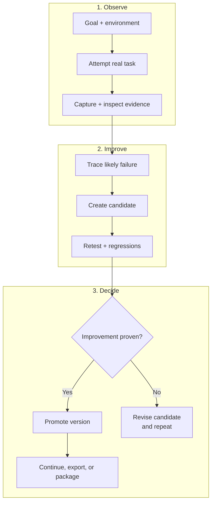

# Ciclo de vida de Harneloop - Compacto

Esta versión conserva solo el ciclo principal de evolución del harness respaldado por evidencia. Sus tres filas apiladas están pensadas para ser legibles en GitHub Markdown y convertirse claramente en un gráfico de aproximadamente 4:3.

El harness promovido no cambia hasta que la barrera de evidencia confirma una mejora. Un candidato puede agrupar cambios relacionados y pueden coexistir candidatos independientes. La validación se ajusta al impacto; un candidato rechazado vuelve al diagnóstico y la revisión sin sustituir la versión actual.

Consulta [Cómo funciona Harneloop](framework-process.md) para ver el diagrama completo de arquitectura.

El código fuente Mermaid está disponible en [`docs/diagrams/framework-process-compact.mmd`](../../../diagrams/framework-process-compact.mmd).
