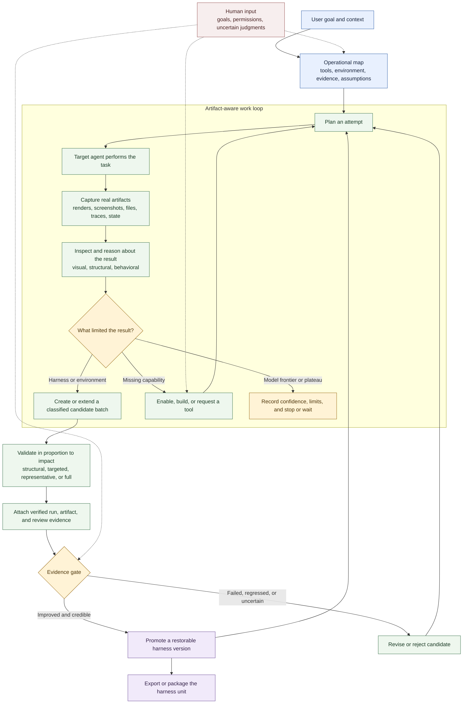

# Cómo funciona Harneloop

Harneloop da al agente operador un ciclo persistente, condicionado por evidencia, para mejorar el harness de un agente objetivo. El agente operador sigue eligiendo cómo trabajar: Harneloop registra la evolución del entorno, los artefactos, los cambios candidatos y el historial de promociones sin reducir el proceso a un script fijo de pruebas.

Para una versión de tres etapas más pequeña, adecuada para un README o un gráfico de aproximadamente 4:3, consulta el [ciclo de vida compacto](framework-process-compact.md).

## Los tres roles

**El agente operador** descubre el entorno real, elige pruebas, utiliza o añade capacidades, inspecciona artefactos, diagnostica fallos y propone cambios candidatos del harness.

**La unidad de harness** contiene instrucciones reutilizables, herramientas, observadores, validadores, ejemplos, declaraciones de infraestructura, mapa operativo, candidatos y versiones promovidas para una familia de tareas.

**El motor Harneloop** controla la integridad del ciclo de vida: registros atómicos, ejecuciones terminadas inmutables, estado protegido del framework, referencias de evidencia validadas, promoción de candidatos, instantáneas, reversión, empaquetado y exportaciones.

## Qué evoluciona

Un candidato puede cambiar más que un prompt. Puede añadir o modificar herramientas, datos de recuperación, ejemplos, instrucciones para agentes, validadores, observadores, investigación, declaraciones de infraestructura o automatización del entorno. Es un lote coherente, por lo que los cambios relacionados pueden acumularse sin exigir una prueba completa tras cada edición. Pueden coexistir candidatos independientes del harness objetivo, evaluación e infraestructura. La promoción convierte un candidato exitoso en una versión restaurable; los candidatos con la base anterior se conservan, pero necesitan rebase y evidencia nueva.

## Qué deja abierto el diagrama

La ejecución exacta de la tarea y la estrategia de evaluación son deliberadamente específicas de cada unidad. Una unidad Blender puede usar un servidor MCP e inspeccionar renders o el estado de la escena. Una unidad SVG puede renderizar en un navegador y comparar evidencia visual y estructural. Harneloop aporta el proceso y los límites de integridad; el agente operador relaciona cada entorno real con ellos.
