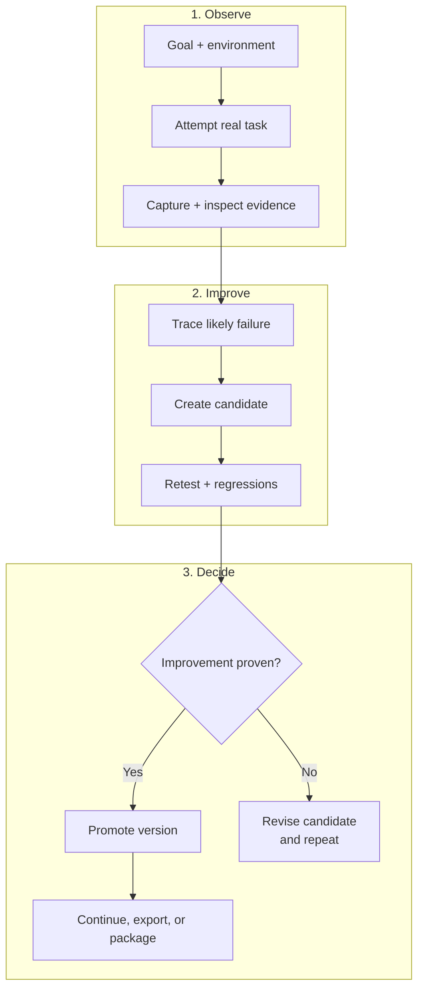

# Cycle de vie Harneloop - Compact

Cette version conserve seulement la boucle centrale d’évolution du harness étayée par des preuves. Ses trois rangées empilées restent lisibles dans GitHub Markdown et se transposent facilement en un graphique d’environ 4:3.

Le harness promu reste inchangé tant que le contrôle des preuves ne confirme pas une amélioration. Un candidat peut regrouper des changements liés et des candidats indépendants peuvent coexister. La validation est proportionnelle à l’impact ; un candidat rejeté revient au diagnostic et à la révision sans remplacer la version actuelle.

Consultez [Comment fonctionne Harneloop](framework-process.md) pour le diagramme d’architecture complet.

Le code source Mermaid est disponible dans [`docs/diagrams/framework-process-compact.mmd`](../../../diagrams/framework-process-compact.mmd).
