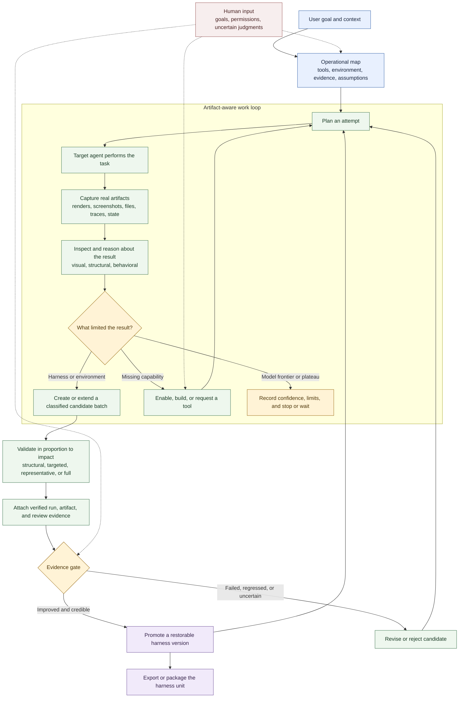

# Comment fonctionne Harneloop

Harneloop donne à l’agent opérateur une boucle persistante, soumise à des preuves, pour améliorer le harness d’un agent cible. L’agent opérateur choisit toujours sa manière de travailler : Harneloop consigne l’environnement évolutif, les artefacts, les changements candidats et l’historique des promotions sans réduire le processus à un script de test figé.

Pour une version plus petite en trois étapes, adaptée à un README ou à un graphique d’environ 4:3, consultez le [cycle de vie compact](framework-process-compact.md).

## Les trois rôles

**L’agent opérateur** découvre l’environnement réel, choisit les tests, utilise ou ajoute des capacités, inspecte les artefacts, diagnostique les échecs et propose des changements candidats du harness.

**L’unité de harness** porte les instructions réutilisables, outils, observateurs, validateurs, exemples, déclarations d’infrastructure, carte opérationnelle, candidats et versions promues pour une famille de tâches.

**Le moteur Harneloop** garantit l’intégrité du cycle de vie : enregistrements atomiques, exécutions terminées immuables, état protégé du framework, références de preuves validées, promotion des candidats, instantanés, retour arrière, empaquetage et exports.

## Ce qui évolue

Un candidat peut modifier plus qu’un prompt : outils, données de recherche, exemples, instructions d’agents, validateurs, observateurs, recherche, déclarations d’infrastructure ou automatisation de l’environnement. Il forme un lot cohérent ; les modifications liées peuvent s’accumuler sans imposer un test complet après chacune. Des candidats indépendants de harness cible, d’évaluation et d’infrastructure peuvent coexister. La promotion transforme un candidat réussi en version restaurable ; ceux sur l’ancienne base restent disponibles mais exigent un rebase et de nouvelles preuves.

## Ce que le diagramme laisse ouvert

L’exécution exacte et la stratégie d’évaluation sont volontairement propres à chaque unité. Une unité Blender peut utiliser un serveur MCP et inspecter rendus ou état de la scène. Une unité SVG peut effectuer les rendus dans un navigateur et comparer preuves visuelles et structurelles. Harneloop fournit le processus et les limites d’intégrité ; l’agent opérateur y rattache chaque environnement réel.
