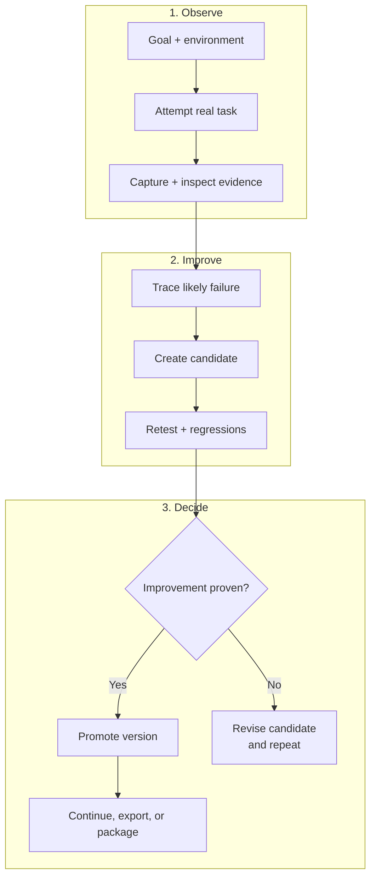

# Harneloop ライフサイクル - コンパクト版

この版は、証拠に裏付けられたハーネス進化の中心的なループだけを示します。縦に並ぶ 3 行は GitHub Markdown でも読みやすく、約 4:3 の図に変換しやすい構成です。

昇格済みのハーネスは、証拠ゲートが改善を確認するまで変わりません。候補は関連変更をまとめられ、独立した候補は共存できます。検証は影響に応じて調整され、却下された候補は現在の版を置き換えずに診断と修正へ戻ります。

完全なアーキテクチャ図は [Harneloop の仕組み](framework-process.md) を参照してください。

Mermaid の元ソースは [`docs/diagrams/framework-process-compact.mmd`](../../../diagrams/framework-process-compact.mmd) にあります。
