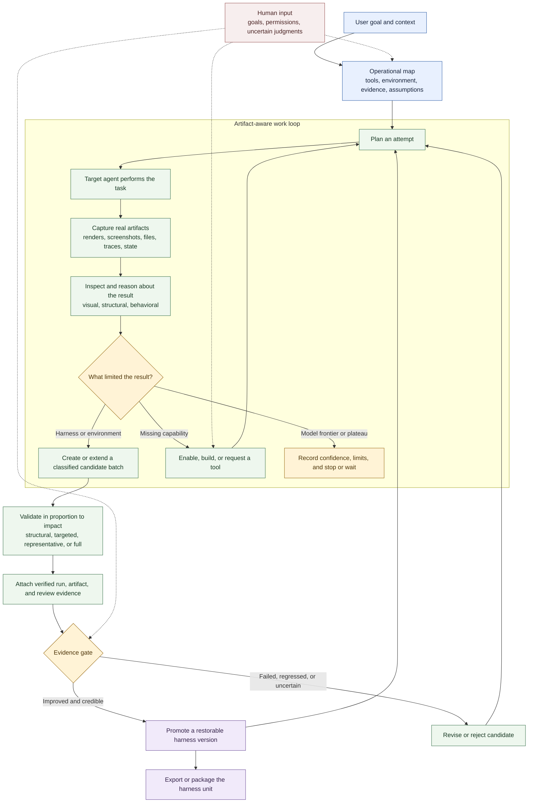

# Harneloop の仕組み

Harneloop は操作エージェントに、対象エージェントのハーネスを改善するための、証拠を条件とする永続的なループを提供します。作業方法は引き続き操作エージェントが選びます。Harneloop は、変化する環境、成果物、候補変更、昇格履歴を記録し、固定テストスクリプトに限定しません。

README や約 4:3 の図に適した、より小さな 3 段階版は[コンパクトなライフサイクル](framework-process-compact.md)を参照してください。

## 3 つの役割

**操作エージェント**は実環境の調査、テストの選択、能力の使用や追加、成果物の確認、失敗の診断、ハーネスの候補変更の提案を行います。

**ハーネスユニット**は、1 つのタスク群に対する再利用可能な指示、ツール、オブザーバー、バリデーター、例、インフラ宣言、運用マップ、候補、昇格済みバージョンを保持します。

**Harneloop エンジン**はライフサイクル整合性を管理します。アトミックな記録、不変な終了済み実行、保護されたフレームワーク状態、検証済み証拠参照、候補の昇格、スナップショット、ロールバック、パッケージ化、エクスポートが含まれます。

## 進化するもの

候補が変えるのはプロンプトだけではありません。ツール、検索データ、例、エージェント指示、バリデーター、オブザーバー、調査、インフラ宣言、環境自動化も追加・修正できます。まとまりのある変更群なので、各変更の直後に完全テストを必須にせず、関連する編集を蓄積できます。対象ハーネス、評価、インフラの独立候補は共存できます。昇格すると成功した候補が復元可能なハーネス版になります。旧ベースの他の候補は残りますが、リベースと新しい証拠が必要です。

## 図が限定しないもの

具体的なタスク実行と評価戦略は、意図的にユニットごとに決めます。Blender ユニットは MCP サーバーでレンダリングやシーン状態を確認でき、SVG ユニットはブラウザで描画して視覚・構造の証拠を比較できます。Harneloop はプロセスと整合性の境界を提供し、操作エージェントが実環境をそれらに対応付けます。
