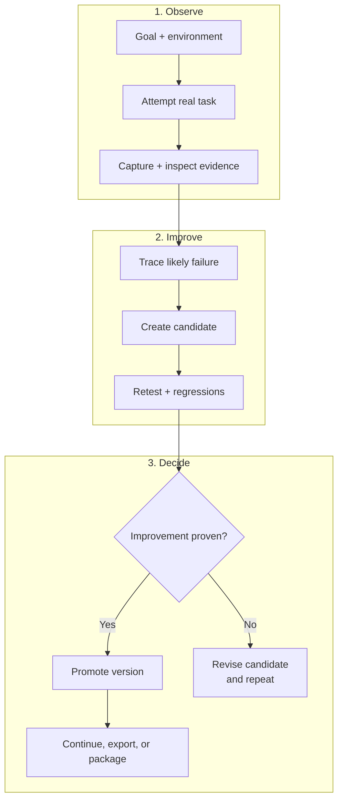

# Ciclo de vida do Harneloop - Compacto

Esta versão mantém apenas o ciclo central de evolução do harness sustentado por evidências. Suas três linhas empilhadas foram pensadas para permanecer legíveis no GitHub Markdown e se converter bem em uma imagem de aproximadamente 4:3.

O harness promovido permanece inalterado até que o controle de evidências confirme uma melhoria. Um candidato pode agrupar mudanças relacionadas, e candidatos independentes podem coexistir. A validação acompanha o impacto; um candidato rejeitado retorna ao diagnóstico e à revisão sem substituir a versão atual.

Veja [Como o Harneloop funciona](framework-process.md) para o diagrama completo de arquitetura.

O código-fonte Mermaid está disponível em [`docs/diagrams/framework-process-compact.mmd`](../../../diagrams/framework-process-compact.mmd).
