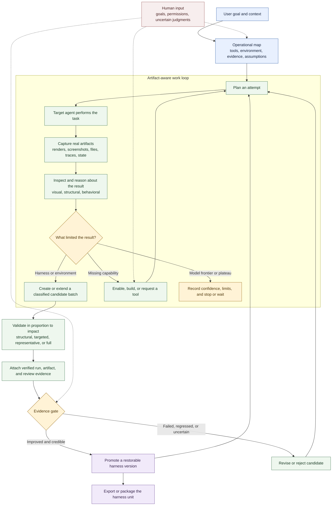

# Como o Harneloop funciona

O Harneloop fornece ao agente operador um ciclo persistente, condicionado por evidências, para melhorar o harness de um agente-alvo. O agente operador continua escolhendo como trabalhar: o Harneloop registra a evolução do ambiente, os artefatos, as mudanças candidatas e o histórico de promoções sem reduzir o processo a um script fixo de testes.

Para uma versão menor em três etapas, adequada ao README ou a uma imagem de aproximadamente 4:3, veja o [ciclo de vida compacto](framework-process-compact.md).

## Os três papéis

**O agente operador** descobre o ambiente real, escolhe testes, usa ou adiciona capacidades, inspeciona artefatos, diagnostica falhas e propõe mudanças candidatas no harness.

**A unidade de harness** reúne instruções reutilizáveis, ferramentas, observadores, validadores, exemplos, declarações de infraestrutura, mapa operacional, candidatos e versões promovidas de uma família de tarefas.

**O motor Harneloop** controla a integridade do ciclo de vida: registros atômicos, execuções finalizadas imutáveis, estado protegido do framework, referências de evidências validadas, promoção de candidatos, snapshots, reversão, empacotamento e exportações.

## O que evolui

Um candidato pode mudar mais que um prompt. Pode adicionar ou revisar ferramentas, dados de recuperação, exemplos, instruções para agentes, validadores, observadores, pesquisa, declarações de infraestrutura ou automação do ambiente. Ele representa um lote coerente, permitindo acumular edições relacionadas sem exigir um teste completo após cada mudança. Candidatos independentes de harness-alvo, avaliação e infraestrutura podem coexistir. A promoção transforma um candidato bem-sucedido em uma versão restaurável; os demais na base antiga permanecem disponíveis, mas exigem rebase e novas evidências.

## O que o diagrama deixa em aberto

A execução exata da tarefa e a estratégia de avaliação são deliberadamente específicas de cada unidade. Uma unidade Blender pode usar um servidor MCP e inspecionar renders ou o estado da cena. Uma unidade SVG pode renderizar saídas no navegador e comparar evidências visuais e estruturais. O Harneloop fornece o processo e os limites de integridade; o agente operador mapeia cada ambiente real para eles.
