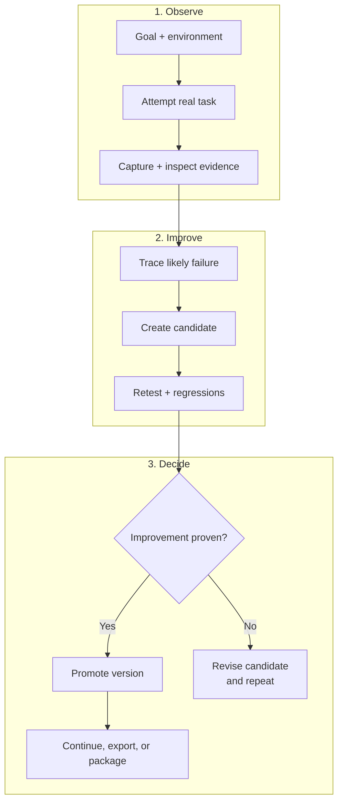

# Harneloop 生命周期 - 精简版

此版本仅保留有证据支持的核心 harness 演化循环。三个纵向排列的行旨在保持 GitHub Markdown 中的可读性，并方便转为约 4:3 的图形。

提升后的 harness 在证据门槛确认改进前保持不变。候选可包含相关的一批变更，独立候选也可共存。验证强度随影响调整；被拒绝的候选返回诊断和修订，不替换当前版本。

完整架构图见 [Harneloop 的工作方式](framework-process.md)。

Mermaid 原始源码位于 [`docs/diagrams/framework-process-compact.mmd`](../../../diagrams/framework-process-compact.mmd)。
