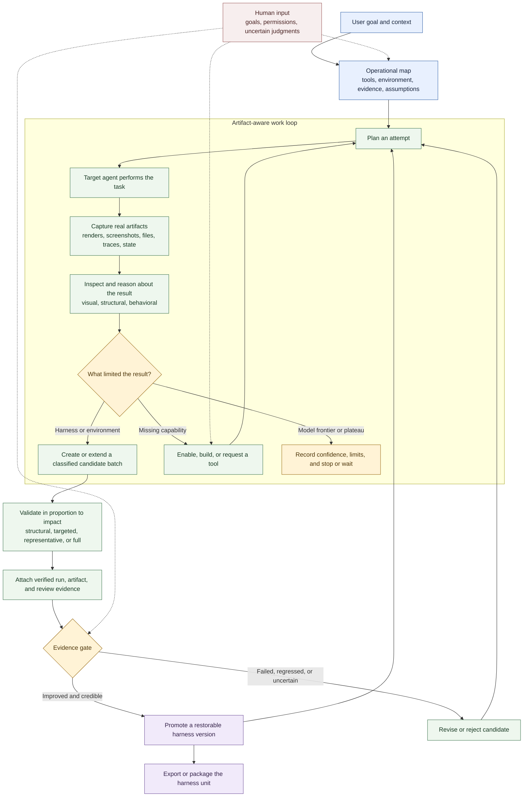

# Harneloop 的工作方式

Harneloop 为操作代理提供持久且以证据为门槛的循环，用于改进目标代理周围的 harness。操作代理仍自行选择工作方式：Harneloop 记录变化中的环境、产物、候选变更和提升历史，而不将流程简化为固定测试脚本。

适合 README 或约 4:3 图形的较小三阶段版本，见[精简生命周期](framework-process-compact.md)。

## 三种角色

**操作代理**发现真实环境、选择测试、使用或增加能力、检查产物、诊断失败，并提出候选 harness 变更。

**harness 单元**承载一个任务类别的可复用指令、工具、观察器、验证器、示例、基础设施声明、操作地图、候选项和已提升版本。

**Harneloop 引擎**负责生命周期完整性：原子记录、不可变的已结束运行、受保护框架状态、已验证证据引用、候选提升、快照、回滚、打包和导出。

## 演化的内容

候选可改变的不只是提示词，还可添加或修订工具、检索数据、示例、代理指令、验证器、观察器、研究、基础设施声明或环境自动化。它代表一批连贯变更，因此相关编辑可以积累，而无需每次修改后完整测试。目标 harness、评估和基础设施的独立候选可并存。提升将成功候选变为可恢复的 harness 版本；基于旧版本的其他候选仍保留，但需变基及新证据。

## 图中保留的自由度

具体任务执行和评估策略刻意由各单元决定。Blender 单元可使用 MCP 服务器并检查渲染图或场景状态；SVG 单元可在浏览器中渲染并比较视觉与结构证据。Harneloop 提供流程和完整性边界；操作代理将每个真实环境映射到这些边界中。
